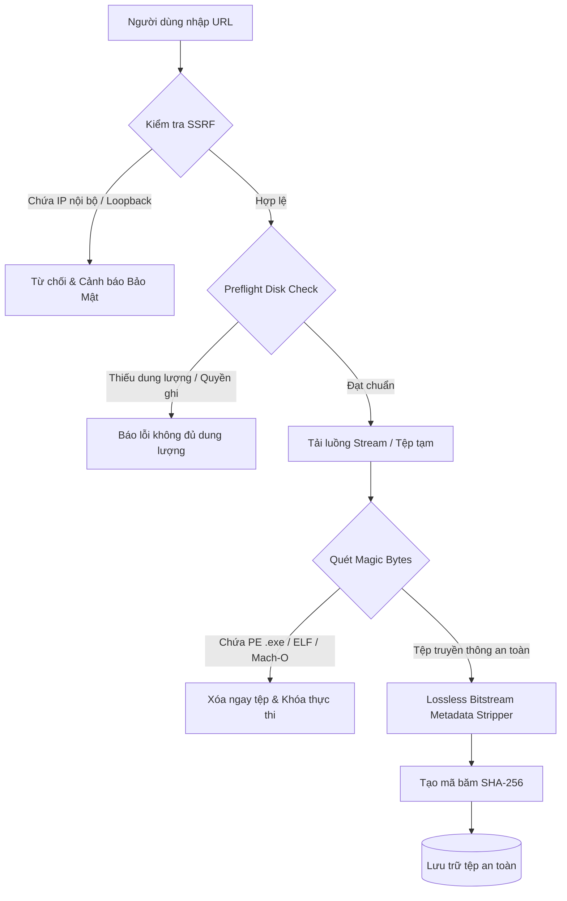

# 🛡️ ToolDowMp4 - Media Security Audit & Downloader (v3.9.0)

<div align="center">


**Ứng dụng Desktop Native chuyên nghiệp trên Linux cho việc phân giải, tải đa phương tiện chất lượng gốc (Master Resolution), nâng cấp ảnh AI Super-Resolution (Real-ESRGAN Vulkan) và kiểm toán an toàn tệp tải về.**

[Tính Năng](#-tính-năng-nổi-bật) • [Ma Trận Nền Tảng](#-bảng-ma-trận-hỗ-trợ-nền-tảng) • [Kiến Trúc](#️-kiến-trúc-hệ-thống) • [Cài Đặt](#-hướng-dẫn-cài-đặt) • [Sử Dụng](#-hướng-dẫn-sử-dụng) • [Kiểm Thử](#-kiểm-thử-tự-động)

</div>

---

## 📖 Giới Thiệu Tổng Quan

**ToolDowMp4** là giải pháp phần mềm mã nguồn mở chạy native trên Linux, kết hợp giữa công cụ bóc tách đa phương tiện chất lượng cao nhất và engine kiểm toán an toàn tệp (Security Audit Engine). 

Dự án ra đời nhằm giải quyết 4 bài toán phổ biến:
1. **Mất độ phân giải trên mạng xã hội**: Các nền tảng như Twitter/X, Pinterest, Facebook thường nén mạnh hình ảnh. ToolDowMp4 tự động chuẩn hóa URL để lấy ảnh gốc kích thước thực (`Master Resolution`).
2. **Ảnh mờ, nhiễu khi tải về**: Tích hợp mô hình AI Super-Resolution **Real-ESRGAN** tăng tốc bằng GPU Vulkan, giúp phóng to ảnh 2x - 4x sắc nét vượt trội.
3. **Mối đe dọa bảo mật khi tải tệp từ Internet**: Tích hợp tầng quét mã độc nhị phân (Magic Bytes Scanner), chặn đứng các tệp thực thi giả mạo (PE `.exe`, Linux ELF, Mach-O), chặn đứng tấn công SSRF và Path Traversal.
4. **Bảo vệ quyền riêng tư người dùng**: Tự động bóc tách và loại bỏ siêu dữ liệu nhạy cảm (GPS, số sê-ri máy ảnh, ngày giờ) trực tiếp trên luồng nhị phân (Lossless Bitstream Clean) mà không làm suy giảm chất lượng ảnh.

---

## 🌟 Tính Năng Nổi Bật

### 1. 🎯 Bóc Tách Độ Phân Giải Gốc (Master Resolution)
- **Twitter / X**: Tự động chuyển đổi endpoint CDN sang `name=orig` để bóc tách tệp ảnh 4K/UHD nguyên bản của tác giả. Tự động phát hiện và trích xuất toàn bộ album/carousel nhiều ảnh.
- **Pinterest**: Nhận diện các ảnh thumbnail `236x`, `736x` và tự động điều hướng sang server gốc `/originals/`.
- **Facebook & Instagram**: Tải video/Reels/ảnh độ phân giải cao nhất, vượt qua các lớp CDN thu gọn.
- **Booru / Rule34 / Anime Art**: Tự động bóc tách thuộc tính `file_url` chất lượng cao nhất, hỗ trợ tải video webm/mp4 và ảnh chất lượng cao.
- **YouTube, TikTok, Reddit, Bilibili, Iwara**: Hỗ trợ độ phân giải từ 360p, 1080p đến 4K/8K 60fps.

### 2. ⚡ AI Super-Resolution & Xử Lý Ảnh Chuyên Sâu (Real-ESRGAN Vulkan)
- **Tăng tốc phần cứng GPU Vulkan**: Sử dụng engine `realesrgan-ncnn-vulkan` tận dụng sức mạnh GPU rời (NVIDIA, AMD, Intel) để nội suy siêu phân giải 2x/4x.
- **Cơ chế SSAA Lanczos Downsampling**: Khi người dùng chọn phóng đại 2x, engine chạy native model 4x trên GPU sau đó áp dụng bộ lọc Lanczos chất lượng cao để khử răng cưa, loại bỏ hoàn toàn lỗi vỡ mảnh ghép (jigsaw puzzle tiles) và sai lệch stride.
- **Cơ chế phòng thủ Zero-Extrema**: Tự động phân tích dải động pixel đầu ra để phát hiện lỗi màn hình đen (thiếu weights model) và kích hoạt fallback bảo vệ dữ liệu.
- **1-Click AI Installer**: Nút tải và cấu hình tự động binary Real-ESRGAN độc lập (~45MB) cùng bộ mô hình `realesrgan-x4plus` tương thích 100% với driver Linux.
- **Chuẩn hóa không gian màu sRGB**: Tự động chuyển đổi RGBA/CMYK sang sRGB, bảo toàn ICC profile gốc, khắc phục triệt để hiện tượng ảnh bị bợt hoặc sai lệch màu trên màn hình Linux.
- **Bộ lọc HD Sharpness**: Tích hợp thuật toán `UnsharpMask` và `autocontrast` giúp khôi phục độ tương phản tự nhiên.

### 3. 🔒 Tầng Kiểm Toán An Toàn & Bảo Mật (Security Hardening)
- **Chống tấn công SSRF (Server-Side Request Forgery)**: Kiểm tra và chặn tất cả URL trỏ vào loopback (`127.0.0.1`, `localhost`), IP nội bộ (RFC 1918: `10.0.0.0/8`, `172.16.0.0/12`, `192.168.0.0/16`) và link-local.
- **Quét chữ ký nhị phân (Magic Bytes Scanner)**: Đối chiếu header nhị phân của tệp đã tải; ngăn chặn các file thực thi nguy hiểm giả dạng ảnh hoặc video:
  - Windows PE (`MZ` / `.exe`, `.dll`)
  - Linux Executable (`\x7fELF`)
  - macOS Mach-O (`\xfe\xed\xfa\xce`, `\xcf\xfa\xed\xfe`)
  - Java Bytecode (`\xca\xfe\xba\xbe`)
- **Lossless Bitstream Clean**: Loại bỏ các thẻ EXIF/GPS ở cấp độ nhị phân trực tiếp trên JPEG marker (`APP1` segment) và PNG chunks (`tEXt`, `zTXt`, `eXIf`), không cần giải nén/nén lại DCT/IDAT nên không làm mất dữ liệu hình ảnh.
- **Tính toán Hash SHA-256**: Xuất mã băm mật mã học giúp người dùng kiểm chứng tính toàn vẹn của tệp tải về.
- **Chống Path Traversal & Preflight Disk Check**: Tự động làm sạch tên file (`sanitize_filename`), kiểm tra dung lượng ổ đĩa khả dụng trước khi ghi.

### 4. ✂️ Cắt Video Không Mất Chất Lượng (Lossless Video Trimming)
- Hỗ trợ cắt đoạn video với cú pháp mốc thời gian linh hoạt:
  - Dạng số thập phân: `0.01` -> 1.0 giây, `0.10` -> 10.0 giây, `1.30` -> 1 phút 30 giây.
  - Dạng chuẩn: `00:01` -> `00:10`, `01:30:00` -> `01:45:00`.
- Sử dụng trực tiếp `download_ranges` và `ffmpeg -c copy` giúp trích xuất đúng đoạn cần lấy mà không cần re-encode, tiết kiệm tối đa thời gian và giữ nguyên 100% chất lượng gốc.

### 5. 🎵 Âm Thanh Chất Lượng Cao & Metadata
- **Spotify & Zing MP3**: Tải âm thanh chất lượng cao 320 kbps, tự động nhúng ảnh bìa Album (Cover Art), tên nghệ sĩ, bài hát và thông tin bản quyền ID3 tag.
- Hỗ trợ tách âm thanh từ bất kỳ video nào thành các định dạng `MP3`, `M4A`, `FLAC`, `WAV`.

### 6. 🎨 Giao Diện Người Dùng & Quản Lý Hàng Đợi (Modern GUI & Queue)
- **Theming Dark / Light Mode**: Giao diện trực quan với bảng màu hiện đại, chuyển đổi tức thì giữa chế độ Tối (Dark) và Sáng (Light). Tự động nhận diện theme hệ thống GNOME/KDE.
- **Hàng đợi tải đa luồng (Queue Manager)**: Thêm nhiều liên kết vào hàng đợi để tải tuần tự mà không làm đóng băng giao diện (Non-blocking Threading).
- **Bộ nhớ đệm thông minh**: Tự động nhận diện link hợp lệ khi sao chép vào Clipboard (Auto-paste detection).

---

## 📊 Bảng Ma Trận Hỗ Trợ Nền Tảng

| Nền tảng | Video | Âm thanh | Ảnh gốc (Master Res) | AI Super-Res | Lossless Trim | Phụ đề |
| :--- | :---: | :---: | :---: | :---: | :---: | :---: |
| **YouTube** | ✅ Tối đa 4K/8K | ✅ MP3 320k | ✅ MaxRes Thumb | ✅ | ✅ | ✅ Đa ngôn ngữ |
| **Twitter / X** | ✅ HD MP4 | ✅ AAC/MP3 | ✅ Gốc (`name=orig`) | ✅ | ✅ | — |
| **Pinterest** | ✅ MP4 | — | ✅ Gốc (`/originals/`) | ✅ | — | — |
| **Facebook** | ✅ 1080p HD | ✅ MP3 | ✅ Full CDN Size | ✅ | ✅ | — |
| **Instagram** | ✅ Reels / Video | ✅ AAC | ✅ High-Res Photo | ✅ | ✅ | — |
| **TikTok** | ✅ Không Watermark | ✅ Original Sound | — | — | ✅ | — |
| **Spotify** | — | ✅ 320 kbps + Cover | — | — | — | — |
| **Booru / R34** | ✅ MP4 / WebM | ✅ Audio | ✅ Full `file_url` | ✅ | ✅ | — |
| **Reddit** | ✅ Kèm âm thanh | ✅ MP3 | ✅ HD Image | ✅ | ✅ | — |
| **Direct URL** | ✅ MP4/MKV/WebM | ✅ MP3/FLAC | ✅ JPG/PNG/WebP | ✅ | ✅ | — |

---

## 🏗️ Kiến Trúc Hệ Thống

Dự án được thiết kế theo mô hình **Phân tầng mô-đun hóa (Modular Layered Architecture)** nhằm đảm bảo tính phân tách trách nhiệm (Separation of Concerns), dễ bảo trì và dễ viết kiểm thử tự động:

```
ToolDowMp4/
├── app_gui/                       # Tầng Giao Diện (Presentation Layer)
│   ├── app.py                     # Lớp App Tkinter, layout, widgets, event bindings
│   └── theme.py                   # Quản lý bảng màu Dark/Light Theme & XDG theme detection
│
├── core/                          # Tầng Điều Khiển & Nghiệp Vụ (Core Business Layer)
│   ├── audit_engine.py            # Engine tải chính: yt-dlp wrapper, stream routing, fallback
│   └── queue_manager.py           # Quản lý hàng đợi đa luồng (Worker threads, thread-safety)
│
├── extractors/                    # Tầng Phân Giải Nền Tảng (Resolvers & Extractors)
│   ├── twitter.py                 # Master Resolution cho Twitter/X (orig query, carousel)
│   ├── pinterest.py               # Phân giải ảnh gốc Pinterest (/originals/)
│   ├── facebook.py                # Phân giải ảnh/video Facebook HD
│   ├── booru.py                   # Phân giải Danbooru/Gelbooru/Rule34
│   ├── spotify.py                 # Phân giải âm thanh Spotify & Zing MP3
│   ├── playlist.py                # Trích xuất danh sách phát video
│   ├── subtitles.py               # Tải và xử lý phụ đề VTT/SRT
│   ├── direct.py                  # Phân giải tệp trực tiếp qua HTTP
│   └── telegram.py                # Hỗ trợ bot/kênh chia sẻ
│
├── image_engine/                  # Tầng Xử Lý Hình Ảnh & AI (Image & Vision Engine)
│   ├── ai_upscaler.py             # Điều khiển Real-ESRGAN Vulkan NCNN GPU, SSAA Lanczos
│   ├── color_restore.py           # Chuẩn hóa sRGB, khôi phục ICC, UnsharpMask, Autocontrast
│   ├── metadata.py                # Bóc tách EXIF/GPS ở mức bitstream nhị phân không mất chất lượng
│   └── processor.py               # Chuyển đổi định dạng, nén, trích xuất khung hình video
│
├── utils/                         # Tầng Tiện Ích & An Ninh (Security & Utilities)
│   ├── security.py                # Quản lý SSRF, Magic Bytes, SHA-256 hash, DRM detector
│   ├── network.py                 # Phân tích định dạng URL, kiểm tra kết nối mạng
│   ├── config.py                  # Lưu trữ cấu hình chuẩn XDG (~/.config/tooldowmp4/)
│   ├── logger.py                  # Ghi nhật ký xoay vòng RotatingFileHandler (~/.local/share/)
│   ├── cleanup.py                 # Dọn dẹp tệp rác tạm thời .tmp/.part khi khởi động
│   ├── helpers.py                 # Xử lý thời gian, định dạng dung lượng, thumbnail
│   └── constants.py               # Định nghĩa các hằng số hệ thống, MIME types, themes
│
├── tests/                         # Bộ Kiểm Thử Tự Động (Unit Test Suite)
│   ├── test_security.py           # Kiểm thử SSRF, Magic Bytes, Hash, DRM
│   ├── test_extractors.py         # Kiểm thử bóc tách Twitter, Pinterest, Facebook
│   ├── test_image_engine.py       # Kiểm thử sRGB, Metadata stripper, AI upscaler
│   └── test_config_cleanup.py     # Kiểm thử Atomic config và temp cleanup
│
├── main.py                        # Entry point chính thức của ứng dụng
├── media_security_downloader.py   # Facade tương thích ngược với các bản build trước
└── media-downloader.desktop       # Tệp tích hợp Desktop Menu trên Linux
```

---

## 🔒 Cơ Chế Bảo Mật & Kiểm Toán



---

## 🚀 Hướng Dẫn Cài Đặt

### 1. Yêu Cầu Hệ Thống
- **Hệ điều hành**: Linux (Ubuntu 20.04+, Debian 11+, Arch Linux, Fedora 36+, Linux Mint...).
- **Python**: Phiên bản `3.10` trở lên.
- **Công cụ phụ trợ**: `ffmpeg` (xử lý media), `vulkan-tools` / Vulkan driver (để chạy Real-ESRGAN GPU).

### 2. Cài Đặt Gói Hệ Thống

#### Trên Ubuntu / Debian / Linux Mint:
```bash
sudo apt update
sudo apt install -y python3 python3-pip python3-tk ffmpeg libvulkan1 vulkan-tools
```

#### Trên Arch Linux / Manjaro:
```bash
sudo pacman -Syu
sudo pacman -S --needed python python-pip tk ffmpeg vulkan-icd-loader vulkan-tools
```

#### Trên Fedora / RHEL:
```bash
sudo dnf install -y python3 python3-pip python3-tkinter ffmpeg vulkan-loader vulkan-tools
```

### 3. Cài Đặt Thư Viện Python
Khuyến nghị tạo môi trường ảo (Virtualenv):
```bash
# Clone hoặc tải repository về máy
cd ToolDowMp4

# Tạo và kích hoạt môi trường ảo
python3 -m venv venv
source venv/bin/activate

# Cài đặt các thư viện phụ thuộc
pip install -r requirements.txt
```

---

## 💻 Hướng Dẫn Sử Dụng

### 1. Khởi Chạy Ứng Dụng
```bash
# Khởi chạy qua entry point chính:
python3 main.py

# Hoặc khởi chạy qua facade tương thích:
python3 media_security_downloader.py
```

### 2. Tạo Shortcut Trên Menu Desktop Linux
Để ứng dụng xuất hiện trong danh sách ứng dụng hệ thống (App Launcher / Dash):
```bash
cp media-downloader.desktop ~/.local/share/applications/
update-desktop-database ~/.local/share/applications/
```

### 3. Tải Video & Âm Thanh Cơ Bản
1. Dán liên kết video (YouTube, TikTok, Facebook, Twitter...) vào ô **URL**.
2. Chọn định dạng: `MP4` (Video) hoặc `MP3` (Âm thanh).
3. Chọn chất lượng mong muốn (`Tốt nhất`, `1080p`, `720p`, `4K`...).
4. Bấm **Tải Ngay**.

### 4. Tải Ảnh Gốc (Master Resolution) & Nâng Cấp AI
1. Dán link bài viết Twitter / Pinterest / Facebook.
2. Tích chọn **Bật AI Super-Resolution** nếu muốn nâng nét ảnh lên 2x hoặc 4x:
   - Nếu chưa có công cụ AI, nhấp nút **"⚡ Cài đặt Real-ESRGAN GPU (~45MB)"** trên giao diện để ứng dụng tự động tải và cấu hình.
3. Bấm **Tải Ngay**. Ảnh tải về sẽ có độ phân giải nguyên bản nhất cùng chi tiết sắc nét.

### 5. Cắt Đoạn Video Nhanh (Lossless Trim)
- Nhập mốc bắt đầu vào ô **Bắt đầu (s)** (ví dụ: `0.01` cho giây thứ 1, hoặc `00:30`).
- Nhập mốc kết thúc vào ô **Kết thúc (s)** (ví dụ: `0.15` cho giây thứ 15, hoặc `01:00`).
- Nhấn **Tải Ngay**. Đoạn video sẽ được cắt nguyên gốc không qua render lại.

---

## 🧪 Kiểm Thử Tự Động (Unit Testing)

Hệ thống đi kèm với bộ kiểm thử tự động toàn diện kiểm tra bảo mật, phân giải nền tảng và engine xử lý ảnh:

```bash
# Chạy toàn bộ 30 unit tests
python3 -m unittest discover tests -v
```

Kết quả kiểm thử bao gồm:
- `test_security.py`: Kiểm thử chặn SSRF (loopback, private IPs), phát hiện chữ ký tệp độc hại (PE/ELF/Mach-O), phát hiện DRM và tính băm SHA-256.
- `test_extractors.py`: Kiểm thử chuẩn hóa URL ảnh gốc Twitter (`name=orig`), Pinterest (`/originals/`), Facebook và Booru.
- `test_image_engine.py`: Kiểm thử chuyển đổi màu sRGB, làm sạch EXIF nhị phân lossless, phát hiện ảnh lỗi AI (extrema = 0) và fallback Lanczos.
- `test_config_cleanup.py`: Kiểm thử đọc/ghi cấu hình nguyên tử XDG và bộ dọn rác tệp tạm mồ côi.

---

## ⚙️ Cấu Hình & Tệp Hệ Thống

Ứng dụng tuân thủ nghiêm ngặt chuẩn **XDG Base Directory Specification** trên Linux:

| Thành phần | Đường dẫn mặc định | Mô tả |
| :--- | :--- | :--- |
| **Cấu hình (Config)** | `~/.config/tooldowmp4/settings.json` | Lưu tùy chọn thư mục tải, chất lượng, theme, clipboard |
| **Nhật ký (Logs)** | `~/.local/share/tooldowmp4/app.log` | Ghi log tự xoay vòng (Rotating log, tối đa 5MB x 3 bản sao) |
| **AI Binary** | `~/.local/share/media-downloader/bin/` | Chứa binary `realesrgan-ncnn-vulkan` và models |
| **Thư mục tải** | `~/Downloads` (Mặc định) | Thư mục lưu trữ các tệp đã hoàn tất |

---

## 🤝 Đóng Góp & Phát Triển

Mọi đóng góp, báo cáo lỗi (Bug Report) và đề xuất tính năng (Feature Request) đều được hoan nghênh:
1. Fork dự án trên GitHub.
2. Tạo nhánh tính năng mới (`git checkout -b feature/AmazingFeature`).
3. Commit các thay đổi (`git commit -m 'feat: Add some AmazingFeature'`).
4. Chạy kiểm thử tự động để đảm bảo không có lỗi phát sinh (`python3 -m unittest discover tests`).
5. Đẩy lên nhánh của bạn (`git push origin feature/AmazingFeature`).
6. Tạo một **Pull Request** mới.

---

## 📜 Giấy Phép (License)

Dự án được phân phối dưới giấy phép **MIT License**. Xem thêm chi tiết tại tệp [LICENSE](LICENSE).

*Tuyên bố miễn trừ trách nhiệm: Ứng dụng được phát triển phục vụ mục đích kiểm thử an ninh, học tập và lưu trữ cá nhân hợp pháp. Vui lòng tuân thủ điều khoản dịch vụ của các nền tảng và luật bản quyền sở hữu trí tuệ.*
